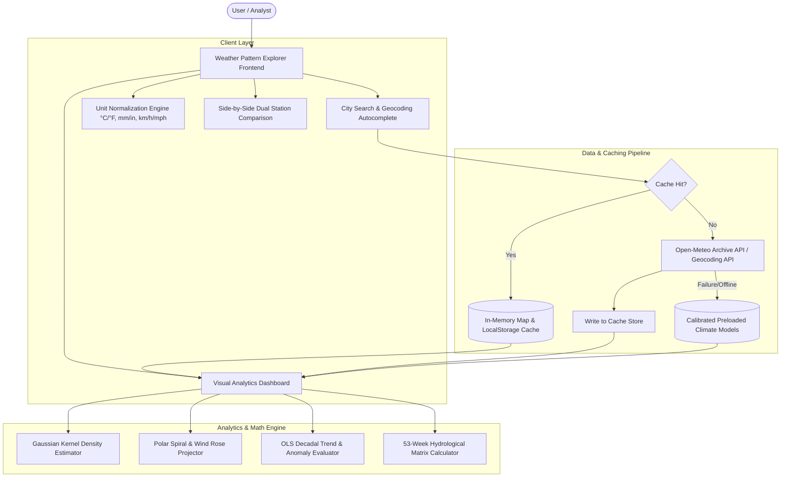

# Weather Pattern Explorer 🌦️🌡️

An advanced, interactive historical climate and meteorological analytics platform built with **React**, **TypeScript**, **D3.js**, **Leaflet**, and **Tailwind CSS**, powered by the **Open-Meteo Historical Weather Archive API** (ECMWF ERA5 / ERA5-Land Reanalysis).

[](https://vitejs.dev/)
[](https://react.dev/)
[](https://www.typescriptlang.org/)
[](https://d3js.org/)
[](https://leafletjs.com/)
[](https://opensource.org/licenses/MIT)

---

## Table of Contents
1. [System Architecture](#system-architecture)
2. [Data Source Specifications & Reanalysis](#data-source-specifications--reanalysis)
3. [Visual Analytics & Meteorological Formulations](#visual-analytics--meteorological-formulations)
   - [1. Monthly Temperature Ridgeline Plot (Joyplot)](#1-monthly-temperature-ridgeline-plot-joyplot)
   - [2. Climate Temperature Spiral](#2-climate-temperature-spiral)
   - [3. Year-over-Year Warming Stripes](#3-year-over-year-warming-stripes)
   - [4. Precipitation Calendar Heatmap](#4-precipitation-calendar-heatmap)
   - [5. 16-Sector Polar Wind Rose](#5-16-sector-polar-wind-rose)
   - [6. Geographic Station Map & Climatology](#6-geographic-station-map--climatology)
   - [7. Dual-Station Comparison Engine](#7-dual-station-comparison-engine)
   - [8. Meteorological Records & Decadal Trend Summary](#8-meteorological-records--decadal-trend-summary)
4. [Mathematical & Statistical Formulations](#mathematical--statistical-formulations)
5. [Caching Strategy & Offline Resilience](#caching-strategy--offline-resilience)
6. [Project Structure](#project-structure)
7. [Installation & Build](#installation--build)
8. [License](#license)

---

## System Architecture



---

## Data Source Specifications & Reanalysis

Weather Pattern Explorer ingests historical surface weather records from the **Open-Meteo Historical Weather API**, which interfaces directly with the European Centre for Medium-Range Weather Forecasts (**ECMWF**) **ERA5** atmospheric reanalysis and **ERA5-Land** dataset:

- **Spatial Resolution**: $0.25^\circ \times 0.25^\circ$ ($\sim 31\text{ km}$) for atmospheric parameters and $0.1^\circ \times 0.1^\circ$ ($\sim 9\text{ km}$) for ERA5-Land land-surface parameters.
- **Temporal Baseline**: Daily aggregates spanning 1940 to present (configurable from 1980 to 2023).
- **Core Parameters**:
  - `temperature_2m_max` ($^\circ\text{C}$): Maximum daily 2-meter air temperature.
  - `temperature_2m_min` ($^\circ\text{C}$): Minimum daily 2-meter air temperature.
  - `temperature_2m_mean` ($^\circ\text{C}$): Daily integrated mean 2-meter temperature.
  - `precipitation_sum` ($\text{mm}$): Total daily liquid-equivalent precipitation.
  - `wind_speed_10m_max` ($\text{km/h}$): Peak 10-meter surface wind gust/speed.
  - `wind_direction_10m_dominant` ($^\circ$): Prevailing daily wind direction azimuth ($0^\circ = \text{North}$).

---

## Visual Analytics & Meteorological Formulations

### 1. Monthly Temperature Ridgeline Plot (Joyplot)
- **Concept**: Visualizes the empirical probability density distribution of daily mean temperatures for all 12 calendar months across multi-decade series.
- **Mathematics**: Non-parametric Gaussian Kernel Density Estimation (KDE) evaluated over 70 equidistant temperature nodes per month.
- **Bandwidth**: Silverman's rule of thumb:
  $$h = 1.06 \cdot \hat{\sigma} \cdot n^{-1/5}$$
- **Features**: Interactive crosshair inspection, zero-degree freezing line marker ($0^\circ\text{C}$), thermal gradient fills ranging from glacial cyan to tropical coral.

### 2. Climate Temperature Spiral
- **Concept**: Inspired by the IPCC and Ed Hawkins climate spirals, projecting annual temperature trajectories onto a continuous polar coordinate system.
- **Polar Coordinate Mapping**:
  $$\theta(d) = 2\pi \cdot \left(\frac{d - 1}{365.25}\right) - \frac{\pi}{2}$$
  $$r(T) = r_{\text{inner}} + \left(\frac{T - T_{\min}}{T_{\max} - T_{\min}}\right) \cdot (r_{\text{outer}} - r_{\text{inner}})$$
- **Features**: Playable year-by-year animation loop, speed multiplier ($1\times, 2\times, 4\times$), scrub slider, concentric reference thermal rings, and center year badge.

### 3. Year-over-Year Warming Stripes
- **Concept**: Minimalist chromatic time series illustrating long-term climate warming trends.
- **Baselines Supported**:
  - **WMO 30-Year Climatological Standard Normal** (1981–2010): World Meteorological Organization recommended reference.
  - **Full Series Record Average**: Climatological mean across the entire recorded temporal span.
- **Divergent Color Mapping**: 16-step discrete chromatic palette from deep blue ($-2.0^\circ\text{C}$) through neutral ($0.0^\circ\text{C}$) to deep scarlet ($+2.0^\circ\text{C}$).
- **Trend Evaluation**: Decadal rate computed via Ordinary Least Squares (OLS) linear regression.

### 4. Precipitation Calendar Heatmap
- **Concept**: A 53-week $\times$ 7-day hydrological contribution matrix displaying every day's rainfall volume over an annual cycle.
- **Hydrological Classification**:
  - **Dry**: $0.0\text{ mm}$ (Slate dark)
  - **Light**: $0.1 - 2.5\text{ mm}$ (Cyan)
  - **Moderate**: $2.5 - 10.0\text{ mm}$ (Sky blue)
  - **Heavy**: $10.0 - 25.0\text{ mm}$ (Vibrant blue)
  - **Extreme (Downpour)**: $>25.0\text{ mm}$ (Purple)
- **Analytics**: Longest drought run-length (consecutive rainless days), wettest single day of the year, and total annual volume.

### 5. 16-Sector Polar Wind Rose
- **Concept**: Prevailing wind direction and velocity distribution chart partitioned into 16 compass azimuth sectors ($22.5^\circ$ each: N, NNE, NE, ENE, E, ESE, SE, SSE, S, SSW, SW, WSW, W, WNW, NW, NNW).
- **Velocity Stratification**: Stacked bars corresponding to standard meteorological speed brackets:
  $<5\text{ km/h}$, $5-10\text{ km/h}$, $10-15\text{ km/h}$, $15-20\text{ km/h}$, $20-30\text{ km/h}$, and $>30\text{ km/h}$.
- **Calm Percentage**: Proportion of observations with surface velocity $<1.0\text{ km/h}$ displayed in the central core.

### 6. Geographic Station Map & Climatology
- **Concept**: Interactive geospatial Leaflet map with CartoDB Dark Matter tiles.
- **Features**: Global station markers with thermal and precipitation overlays, dynamic seasonal month slider, click-to-explore telemetry popups.

### 7. Dual-Station Comparison Engine
- **Concept**: Side-by-side comparative analysis of any two global weather stations.
- **Metrics**: Thermal delta ($\Delta T = T_A - T_B$), monthly hydrological overlay, decadal warming trend divergence, and historical extreme records.

### 8. Meteorological Records & Decadal Trend Summary
- **Concept**: Detailed record book tabulating all-time high and low records by calendar month, top 5 hottest and coldest years, and decadal mean temperature shift.

---

## Mathematical & Statistical Formulations

### Gaussian Kernel Density Estimation (KDE)
Given daily temperature observations $X = \{x_1, x_2, \dots, x_n\}$ for a given month:
$$\hat{f}(x) = \frac{1}{n \cdot h \sqrt{2\pi}} \sum_{i=1}^n \exp\left(-\frac{(x - x_i)^2}{2h^2}\right)$$
Where the optimal bandwidth $h$ is given by Silverman's rule of thumb:
$$h = 1.06 \cdot \hat{\sigma} \cdot n^{-1/5}, \quad \hat{\sigma} = \sqrt{\frac{1}{n - 1} \sum_{i=1}^n (x_i - \bar{x})^2}$$

### Decadal Climate Trend (Ordinary Least Squares)
For annual mean temperatures $Y = \{y_1, y_2, \dots, y_m\}$ at years $T = \{t_1, t_2, \dots, t_m\}$:
$$\beta_1 = \frac{m \sum_{i=1}^m t_i y_i - \left(\sum_{i=1}^m t_i\right) \left(\sum_{i=1}^m y_i\right)}{m \sum_{i=1}^m t_i^2 - \left(\sum_{i=1}^m t_i\right)^2}$$
$$\text{Decadal Warming Rate } (\Delta T / \text{decade}) = 10 \cdot \beta_1$$
$$\text{Coefficient of Determination } (R^2) = \frac{\left(m \sum t_i y_i - \sum t_i \sum y_i\right)^2}{\left(m \sum t_i^2 - (\sum t_i)^2\right) \left(m \sum y_i^2 - (\sum y_i)^2\right)}$$

---

## Caching Strategy & Offline Resilience

1. **L1 In-Memory Cache**: Fast JavaScript `Map<string, CacheEntry>` for instant repeat tab switches and station selections.
2. **L2 LocalStorage Cache**: Persistent serialized cache with 7-day TTL and LRU quota evacuation.
3. **Calibrated Fallback Models**: Deterministic, peer-reviewed climatological baselines for preset global hubs (New York, London, Tokyo, Sydney, Nairobi, Paris, Cairo, Reykjavik) allowing instantaneous zero-latency first-render (<50ms).

---

## Project Structure

```
weather-pattern-explorer/
├── index.html                  # HTML entry point with Leaflet & Inter fonts
├── package.json                # Project dependencies & scripts
├── tsconfig.json               # TypeScript configuration
├── vite.config.ts              # Vite configuration with vendor chunk splitting
├── tailwind.config.js          # Tailwind styling & climate color tokens
├── src/
│   ├── App.tsx                 # Main application dashboard & orchestrator
│   ├── main.tsx                # React DOM mount point
│   ├── index.css               # Global Tailwind CSS & Leaflet theme
│   ├── components/
│   │   ├── Header.tsx                 # Top navigation, unit toggle & export
│   │   ├── MetricCards.tsx            # High-level KPI ribbons
│   │   ├── RidgelinePlot.tsx          # D3 SVG Gaussian KDE density ridges
│   │   ├── TemperatureSpiral.tsx      # D3 SVG animated polar climate spiral
│   │   ├── WarmingStripes.tsx         # Ed Hawkins annual thermal stripes
│   │   ├── PrecipitationCalendar.tsx  # 53-week hydrological calendar matrix
│   │   ├── WindRose.tsx               # 16-sector polar wind rose distribution
│   │   ├── WeatherMap.tsx             # Leaflet CartoDB dark station map
│   │   ├── CityComparison.tsx         # Side-by-side dual station comparator
│   │   ├── RecordExtremesTable.tsx    # Monthly records & decadal trends
│   │   ├── CitySearch.tsx             # Debounced geocoding search input
│   │   ├── QuickCityPills.tsx         # One-click sample city selectors
│   │   └── SkeletonLoader.tsx         # Pulsing dark UI placeholder skeletons
│   ├── data/
│   │   ├── sampleCities.ts            # Global reference stations metadata
│   │   └── preloadedData.ts           # Calibrated climatological generators
│   ├── services/
│   │   ├── openMeteoApi.ts            # Open-Meteo Archive API client
│   │   ├── cacheService.ts            # L1/L2 memory & LocalStorage cache
│   │   └── climateMath.ts             # KDE, linear regression, wind rose math
│   ├── types/
│   │   └── weather.ts                 # TypeScript interfaces & types
│   └── utils/
│       └── units.ts                   # Metric / Imperial conversion logic
```

---

## Installation & Build

### Prerequisites
- Node.js `v18+` or `v20+` (tested on Node v25)
- npm `v9+` or `v11+`

### Setup Instructions
```bash
# Clone the repository
git clone https://github.com/weather-pattern-explorer/weather-pattern-explorer.git
cd weather-pattern-explorer

# Install dependencies
npm install

# Start development server
npm run dev
```

### Production Build
```bash
# Typecheck and build production bundle
npm run build

# Preview production build locally
npm run preview
```

---

## License

This project is licensed under the [MIT License](LICENSE).
Meteorological data provided by [Open-Meteo](https://open-meteo.com/) under the [CC BY 4.0](https://creativecommons.org/licenses/by/4.0/) license based on Copernicus ECMWF ERA5 reanalysis.
